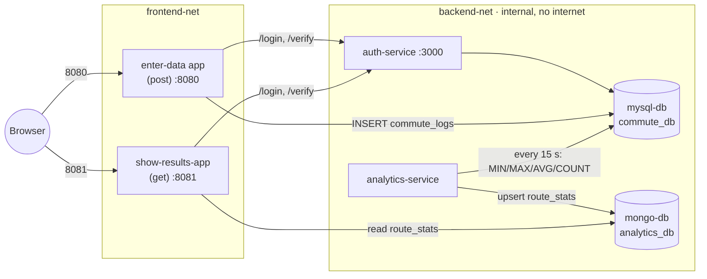

# Commute & Traffic Time Logger

ACIT 3495 Project 1 (Option 1: Data Collection and Analytics System), Group 4.

Users log their commute times in one web app, an analytics service turns them into
per-route statistics (min, max, average, count), and a second web app shows the results.
Everything runs as Docker containers started with one command.

## Group members

- Lincoln
- Taranjot
- Alexis
- Chenyue
- Ziyuan

## Architecture



| Service (compose name) | Folder | Language | Host port | What it does |
| --- | --- | --- | --- | --- |
| `post` (enter-data app) | `post/` | Node.js / Express | **8080** | Form to log a commute; writes to MySQL `commute_logs` |
| `show-results-app` | `get/` | Node.js / Express | **8081** | Shows per-route statistics from MongoDB |
| `auth-service` | `auth/` | Node.js / Express | none | `POST /login`, `GET /verify` (JWT); users in MySQL |
| `analytics` (container `analytics-service`) | `analytics/` | Python | none | Every 15 s reads MySQL, writes stats to MongoDB |
| `mysql-db` | `mysql/` | MySQL 8.0 | none | `commute_db`: `users`, `routes`, `commute_logs` |
| `mongo-db` | `mongo/` | MongoDB 7.0 | none | `analytics_db.route_stats` |

Only the two web apps publish ports. The databases, auth and analytics are reachable
only on the internal Docker network `backend-net`.

## Prerequisites

- Docker Desktop (Windows/macOS) or Docker Engine with the Compose plugin (`docker compose version` should work).
  On Windows, make sure Docker Desktop is **running** before you use any `docker` command.
- Git
- Free host ports **8080** and **8081**


### 1. Clone the repository

```sh
git clone https://github.com/Elena-Ziyuan-Zhao/ACIT-3495-Project1.git
cd ACIT-3495-Project1
```

### 2. Create your `.env`
`.evn.exmple` is an example of what should have in your `.env` file

1. Copy the `.evn.exmple`
2. rename it as `.env`
3. replace every `change_me` value.

Rules for the values:

| Variable | Rule |
| --- | --- |
| `MYSQL_DATABASE` | Keep `commute_db` (the schema in `mysql/init.sql` uses this name) |
| `JWT_SECRET` | At least 32 characters. Generate one: `node -e "console.log(require('crypto').randomBytes(32).toString('hex'))"` |
| `AUTH_SEED_USERNAME` / `AUTH_SEED_PASSWORD` | The demo login created on startup. Password at least 8 characters |
| `MONGO_URI` | The password inside it must equal `MONGO_APP_PASSWORD`. Special characters must be URL-encoded (`@` becomes `%40`) |


### 3. Build and start everything

```sh
docker compose up -d --build
```

The first build downloads base images and takes a few minutes.

### 4. Use the apps

| App | URL | Login |
| --- | --- | --- |
| Enter Data | http://localhost:8080 | `AUTH_SEED_USERNAME` / `AUTH_SEED_PASSWORD` from `.env` |
| Show Results | http://localhost:8081 | same |

1. Log a few commutes in Enter Data.
2. Within about 15 seconds the analytics service updates the statistics.
3. Open Show Results to see min / average / max / trip count per route (the page refreshes every 30 s).

### 6. Shut down

```sh
docker compose down        # -  stop everything, keep the data
docker compose down -v     #  - stop everything and delete all data (fresh start next time)
```


## Running the tests

Each Node service has unit tests that need no running containers. Run them in Docker
(no local Node install needed), from the repository root:

```powershell
# Windows PowerShell
docker run --rm -v "${PWD}/auth:/app" -w /app node:24-alpine sh -c "npm ci && npm test"
docker run --rm -v "${PWD}/get:/app"  -w /app node:24-alpine sh -c "npm ci && npm test"
```

```sh
# macOS / Linux
docker run --rm -v "$PWD/auth:/app" -w /app node:24-alpine sh -c "npm ci && npm test"
docker run --rm -v "$PWD/get:/app"  -w /app node:24-alpine sh -c "npm ci && npm test"
```

## Data and persistence

- MySQL data lives in the named volume `mysql-data`, MongoDB data in `mongo-data`.
- `docker compose down` keeps the data; `docker compose down -v` deletes it.
- The database init scripts (`mysql/init.sql`, `mongo/init/01-init.js`) run **only when
  the volume is empty**. After changing them, or after changing database passwords in
  `.env`, run `docker compose down -v` and start again.


## Service documentation

- [auth/README.md](auth/README.md): auth-service endpoints, environment variables, security choices
- [get/README.md](get/README.md): show-results-app endpoints, environment variables, security choices
- [post/README.md](post/README.md): enter-data app
- [analytics/README.md](analytics/README.md): analytics-service, document format, reliability
