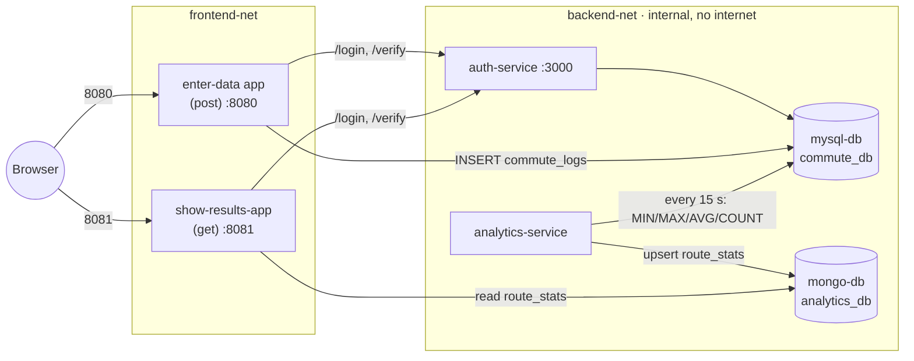

# Commute & Traffic Time Logger

ACIT 3495 Project 1 (Option 1: Data Collection and Analytics System), Group 4.

Users log their commute times in one web app, an analytics service turns them into
per-route statistics (min, max, average, count), and a second web app shows the results.
Everything runs as Docker containers started with one command.

## Group members

- Lincoln
- Taranjot
- Alexis
- Chenyue
- Ziyuan

## Architecture



| Service (compose name) | Folder | Language | Host port | What it does |
| --- | --- | --- | --- | --- |
| `post` (enter-data app) | `post/` | Node.js / Express | **8080** | Form to log a commute; writes to MySQL `commute_logs` |
| `show-results-app` | `get/` | Node.js / Express | **8081** | Shows per-route statistics from MongoDB |
| `auth-service` | `auth/` | Node.js / Express | none | `POST /login`, `GET /verify` (JWT); users in MySQL |
| `analytics` | `analytics/` | Python | none | Every 15 s reads MySQL, writes stats to MongoDB |
| `mysql-db` | `mysql/` | MySQL 8.0 | none | `commute_db`: `users`, `routes`, `commute_logs` |
| `mongo-db` | `mongo/` | MongoDB 7.0 | none | `analytics_db.route_stats` |

Only the two web apps publish ports. The databases, auth and analytics are reachable
only on the internal Docker network `backend-net`.

## Prerequisites

- Docker Desktop (Windows/macOS) or Docker Engine with the Compose plugin (`docker compose version` should work)
- Git
- Free host ports **8080** and **8081**

## Quick start

### 1. Clone the repository

```sh
git clone https://github.com/Elena-Ziyuan-Zhao/ACIT-3495-Project1.git
cd ACIT-3495-Project1
```

### 2. Create your `.env`

Copy the template, then open `.env` and replace every `change_me` value.

```powershell
# Windows PowerShell
Copy-Item .env.example .env
```

```sh
# macOS / Linux
cp .env.example .env
```

Rules for the values:

| Variable | Rule |
| --- | --- |
| `JWT_SECRET` | At least 32 characters. Generate one: `node -e "console.log(require('crypto').randomBytes(32).toString('hex'))"` |
| `AUTH_SEED_USERNAME` / `AUTH_SEED_PASSWORD` | The demo login created on startup. Password at least 8 characters |
| `MONGO_URI` | The password inside it must equal `MONGO_APP_PASSWORD`. Special characters must be URL-encoded (`@` becomes `%40`) |

`.env` is in `.gitignore`. Never commit it.

### 3. Build and start everything

```sh
docker compose up -d --build
```

The first build downloads base images and takes a few minutes.

### 4. Check that everything is running

```sh
docker compose ps
```

Wait until `mysql-db`, `mongo-db`, `auth-service`, `post` and `show-results-app` show
`(healthy)` (about 30–60 seconds on first start).

### 5. Use the apps

| App | URL | Login |
| --- | --- | --- |
| Enter Data | http://localhost:8080 | `AUTH_SEED_USERNAME` / `AUTH_SEED_PASSWORD` from `.env` |
| Show Results | http://localhost:8081 | same |

1. Log a few commutes in Enter Data.
2. Within about 15 seconds the analytics service updates the statistics.
3. Open Show Results to see min / average / max / trip count per route (the page refreshes every 30 s).

## Everyday commands

```sh
docker compose ps                         # status and health of every container
docker compose logs -f                    # follow all logs (JSON lines)
docker compose logs -f show-results-app   # follow one service
docker compose up -d --build <service>    # rebuild and restart one service after code changes
docker compose restart <service>          # restart one service
docker compose down                       # stop and remove containers (data is kept)
docker compose down -v                    # stop and DELETE all data (fresh databases next start)
```

## Checking individual services

The internal services have no host port, so check them from inside their containers:

```sh
# auth-service health
docker compose exec auth-service wget -qO- http://127.0.0.1:3000/health

# show-results-app health
docker compose exec show-results-app wget -qO- http://127.0.0.1:8081/health

# MySQL: list tables
docker compose exec mysql-db sh -c 'mysql -u"$MYSQL_USER" -p"$MYSQL_PASSWORD" commute_db -e "SHOW TABLES;"'

# MongoDB: list the computed statistics
docker compose exec mongo-db sh -c 'mongosh --quiet -u "$MONGO_APP_USER" -p "$MONGO_APP_PASSWORD" --authenticationDatabase analytics_db analytics_db --eval "db.route_stats.find()"'
```

## Running the tests

Each Node service has unit tests that need no running containers. Run them in Docker
(no local Node install needed), from the repository root:

```powershell
# Windows PowerShell
docker run --rm -v "${PWD}/auth:/app" -w /app node:24-alpine sh -c "npm ci && npm test"
docker run --rm -v "${PWD}/get:/app"  -w /app node:24-alpine sh -c "npm ci && npm test"
```

```sh
# macOS / Linux
docker run --rm -v "$PWD/auth:/app" -w /app node:24-alpine sh -c "npm ci && npm test"
docker run --rm -v "$PWD/get:/app"  -w /app node:24-alpine sh -c "npm ci && npm test"
```

## Data and persistence

- MySQL data lives in the named volume `mysql-data`, MongoDB data in `mongo-data`.
- `docker compose down` keeps the data; `docker compose down -v` deletes it.
- The database init scripts (`mysql/init.sql`, `mongo/init/01-init.js`) run **only when
  the volume is empty**. After changing them, or after changing database passwords in
  `.env`, run `docker compose down -v` and start again.

## Troubleshooting

| Symptom | Fix |
| --- | --- |
| `no configuration file provided: not found` | Run the command from the repository root (the folder containing `compose.yaml`) |
| `port is already allocated` | Something else uses 8080 or 8081. Stop it, or change the left side of the port mapping in `compose.yaml` |
| Login says "Invalid username or password" | Check `AUTH_SEED_USERNAME` / `AUTH_SEED_PASSWORD` in `.env`. If the user was created with an old password, run `docker compose down -v` |
| Database login errors after editing `.env` | The init scripts only run once. `docker compose down -v`, then `docker compose up -d --build` |
| Show Results says "No statistics yet" | No commutes logged yet, or analytics is not running: `docker compose logs analytics` |
| A container keeps restarting | `docker compose logs <service>` shows the reason |

## Known issues (work in progress)

Remove each item when it is fixed.

- Enter Data (`post`) still uses a development login (every user is `demo`) instead of `auth-service`.
- `analytics`: `MYSQL_DATABASE` and `MONGO_URI` in `compose.yaml` need to point at `commute_db` and the
  app-user `MONGO_URI` from `.env`, and `last_updated` must be written as a date, otherwise MongoDB rejects the stats.

## Service documentation

- [auth/README.md](auth/README.md): auth-service endpoints, environment variables, security choices
- [get/README.md](get/README.md): show-results-app endpoints, environment variables, security choices
