# Technical Report — Commute & Traffic Time Logger

---

## 1. Functionality & Architecture

### 1.1 Services

| Service | Language / base image | Host port | Responsibility |
|---|---|---|---|
| `post` | Node.js 20 · `node:20-alpine` | 8080 | Login, enter commute duration, write to MySQL |
| `show-results-app` | Node.js · `node:24-alpine` | 8081 | Login, read statistics from MongoDB |
| `auth-service` | Node.js | internal | Verify credentials (bcrypt), issue and verify JWTs |
| `analytics` | Python 3.11 | internal | Every 15 s: aggregate MySQL → upsert MongoDB |
| `mysql-db` | `mysql:8.0` | internal | Users, routes, raw commute logs |
| `mongo-db` | `mongo:7.0` | internal | Aggregated route statistics |

Two languages are used: Node.js and Python.

### 1.2 Networks

| Network | Members | Purpose |
|---|---|---|
| `frontend-net` (bridge) | post, show-results-app | Lets the two web apps publish their host ports (8080, 8081). Nothing else is attached, so no other service is reachable from outside. |
| `backend-net` (`internal: true`) | post, show-results-app, auth-service, analytics, mysql-db, mongo-db | All service-to-service traffic. Marked internal, so it has no route to the host or the internet. |

### 1.3 Data model

- **MySQL `commute_db`**: stores commute_log, users and route

`commute_log`: the log info itself

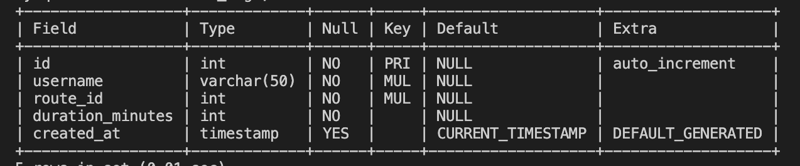

`users`: stores the user info for authentication

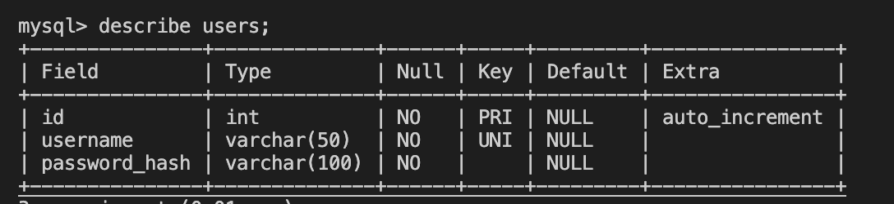

`route`: the sample route for the traffic

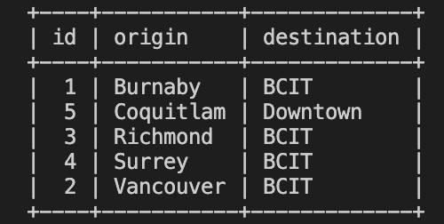

### 1.4 Workflow

> Start from a clean state (`docker compose down -v && docker compose up -d --build`).
> 1. `01-login.png` — http://localhost:8080 redirects to the login page
> 2. `01-entry.png` — after logging in, the form with a saved trip in "Your recent trips"
> 3. `01-results.png` — ~15 s later, http://localhost:8081 showing the statistics table

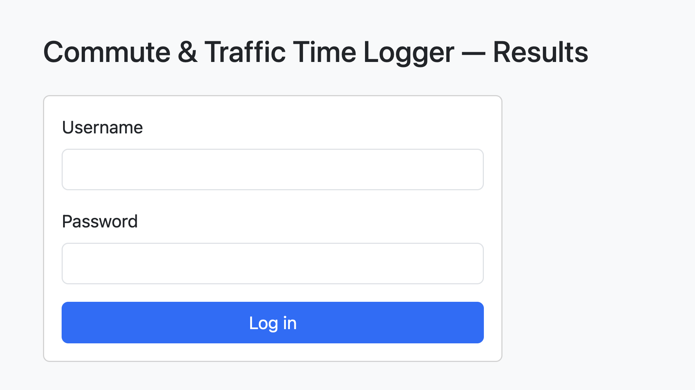
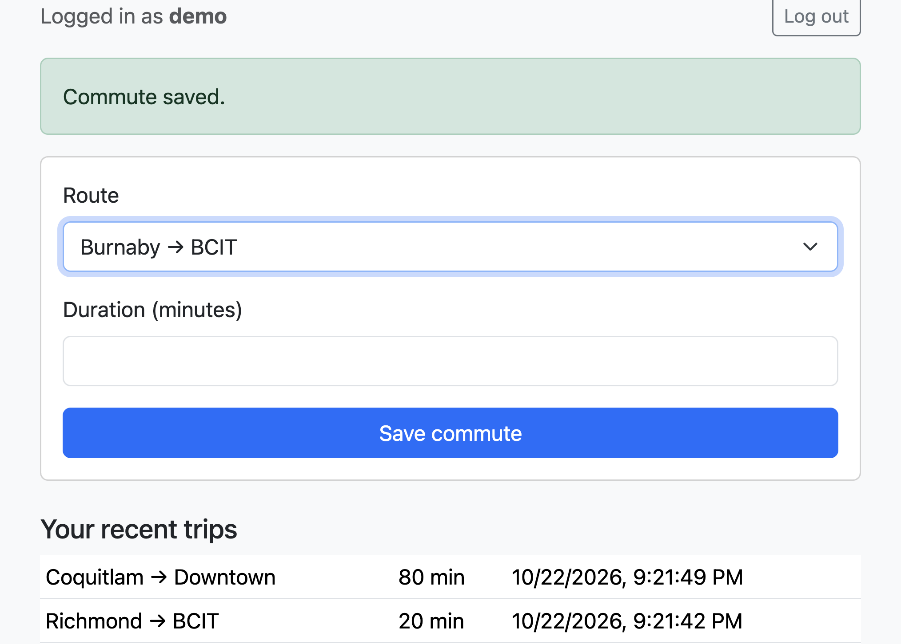
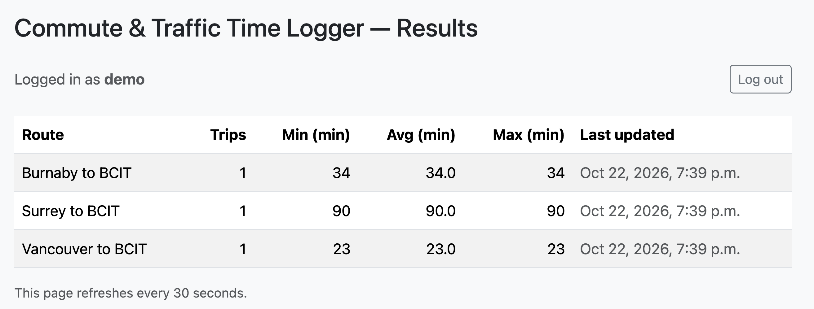

---

## 2. Docker & Optimization

## 3. Security

### 3.1 Secret handling

- All credentials come from environment variables; Compose reads them from `.env`.
- `.env` is in `.gitignore`; only `.env.example` with `change_me` placeholders is committed.
- CI uses GitHub Actions Secrets / `GITHUB_TOKEN`; no credentials appear in the workflow file.
- `auth-service` refuses to start if `JWT_SECRET` is shorter than 32 characters.

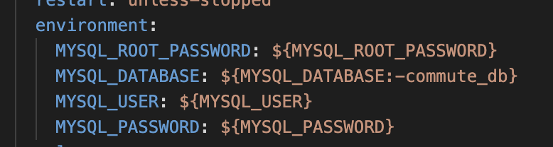

### 3.2 Private internal services

Only the two web apps publish ports. `backend-net` is `internal: true`, so even the
databases cannot make outbound internet connections.

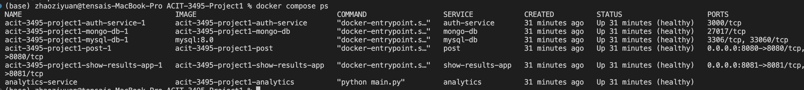

### 3.3 Least privilege

- Custom images run as a non-root user.
- Applications connect with dedicated database users (`commute_app`, `analytics_user`), not root.
- Core services are running with read_only previledge

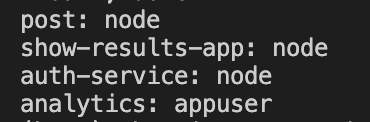

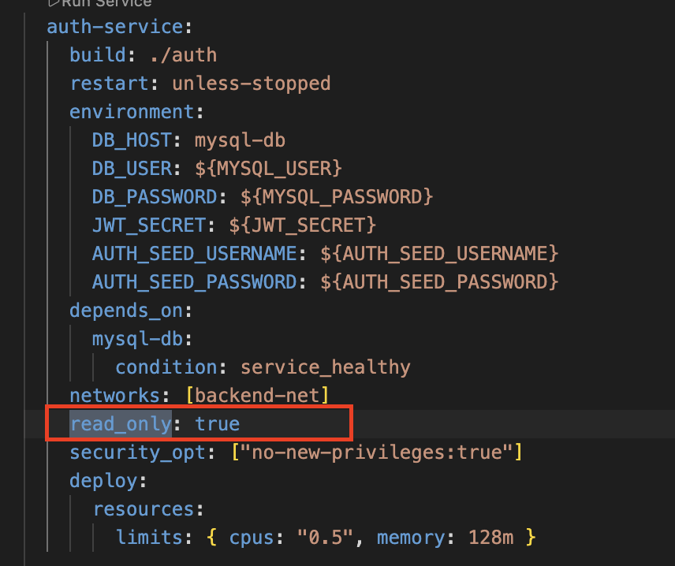

### 3.4 Access control

1. Passwords are stored as bcrypt hashes. An unknown username is checked against a dummy hash,
   so response time does not reveal whether the user exists.
2. On login, `auth-service` returns a signed JWT (HS256, issuer-checked, 1-hour expiry).
3. An invalid or expired token clears the cookie and redirects to `/login`.

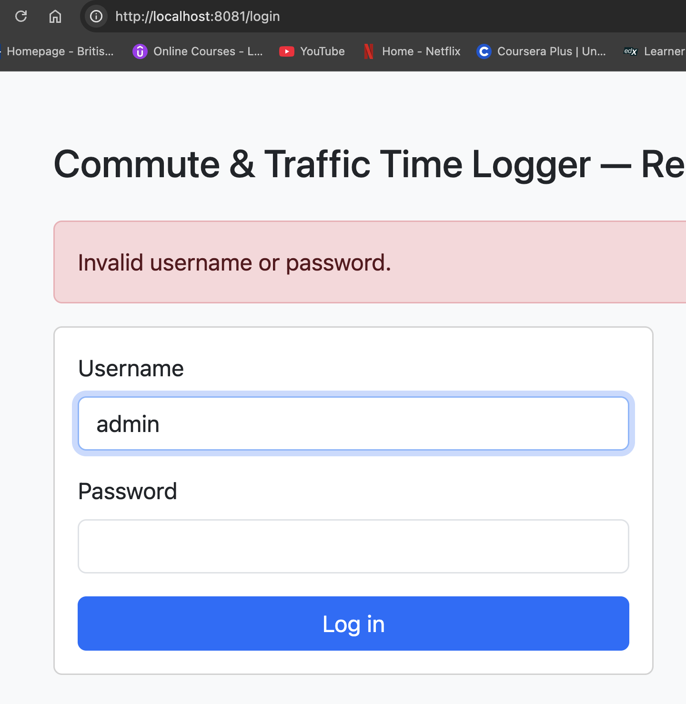

### 3.5 Vulnerability scan

Tools used - Trivy

**Image scanned:** `auth-service` — the most security-sensitive service, since it handles
passwords and signs tokens.

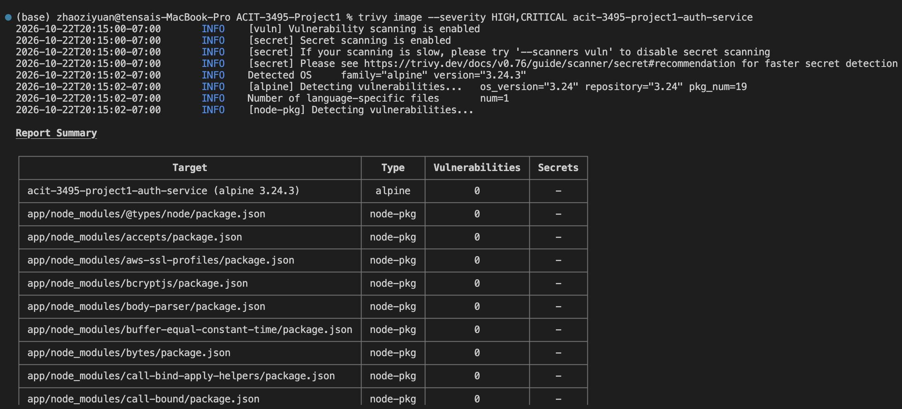

Result: 0 HIGH and 0 CRITICAL vulnerabilities.

---

## 4. Reliability

### 4.1 Health checks

## 5. Failure test
**What we did:** stopped MySQL while a user was logged in, tried to save a commute, then restarted MySQL.

1. `docker compose stop mysql-db` — MySQL goes down.
2. Submitting a commute on :8080 shows a friendly page: "The database is temporarily unavailable". The app does not crash.
3. `docker compose logs post` shows a JSON error with `code: ENOTFOUND`. While MySQL is stopped, its hostname `mysql-db` disappears from Docker's internal DNS. The log contains no stack trace and no passwords.
4. `docker compose ps` shows `post` as `unhealthy`, because its `/health` check also tests the database. `auth-service` turns `unhealthy` too, since it needs MySQL to look up users.
5. `docker compose start mysql-db` — MySQL comes back.
6. Within about 15 seconds both services return to `healthy`, and a new commute saves successfully

`post` uses a MySQL connection pool. When a query fails, the pool drops the broken connection, and the next request opens a new one. Once MySQL is back, the app works again on its own.

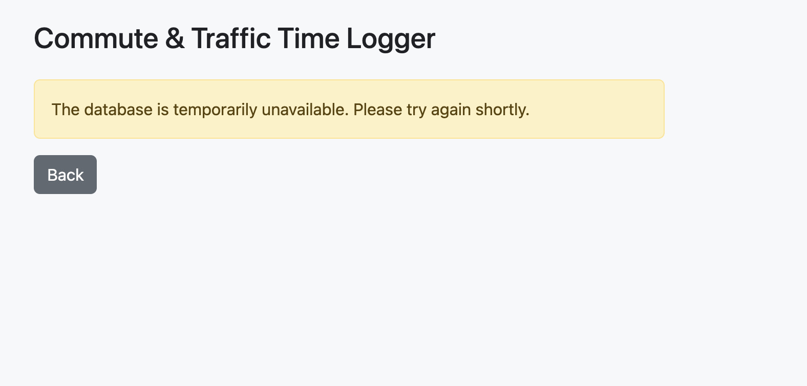
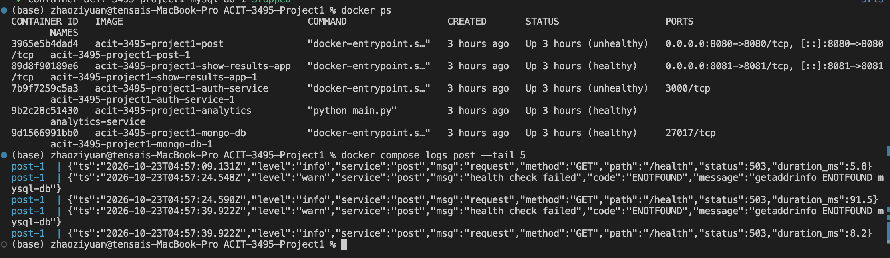
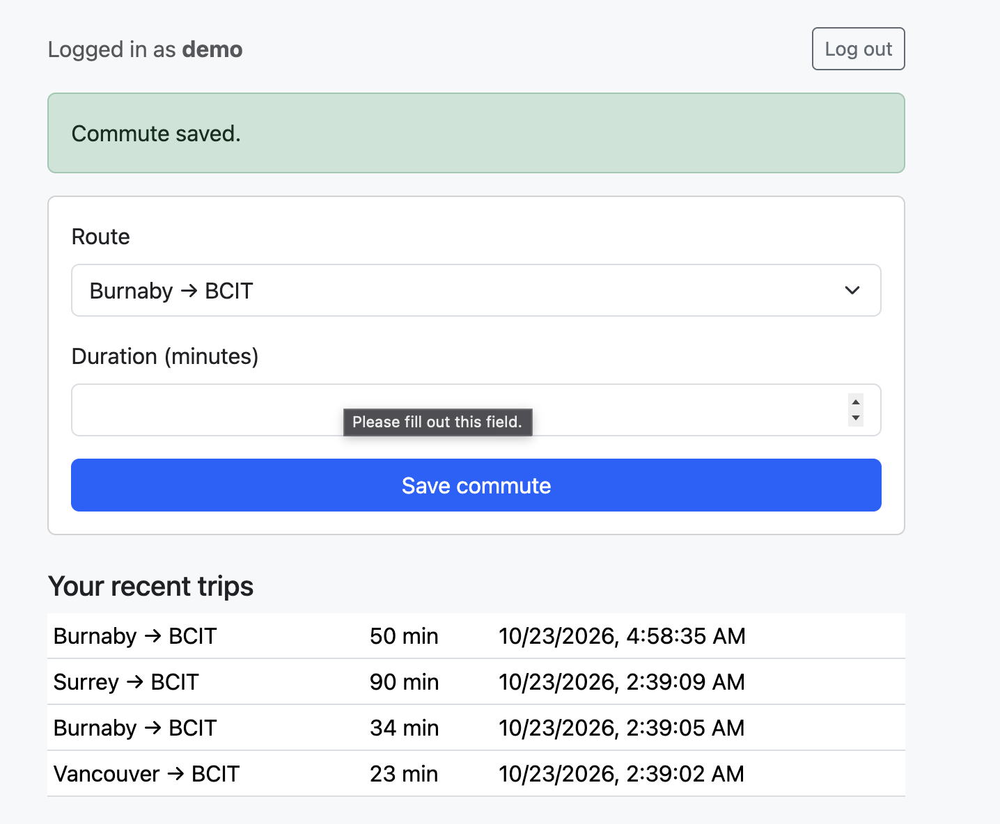

### 5.2 Failure test 2 — auth-service stops

**What we did:** stopped the authentication service while a user was logged in, then restarted it.

1. `docker compose stop auth-service` — auth-service goes down.
2. Refreshing :8080 shows "The authentication service is temporarily unavailable" (HTTP 503).
3. `docker compose start auth-service` — auth-service comes back.
4. Refreshing :8080 works again, and the user is still logged in.

Every page checks the token with auth-service. If the token cannot be checked, the app refuses the request instead of letting the user in — the system fails closed. After the restart the existing token is still valid, because it is signed with the same `JWT_SECRET`, so users do not need to log in again.

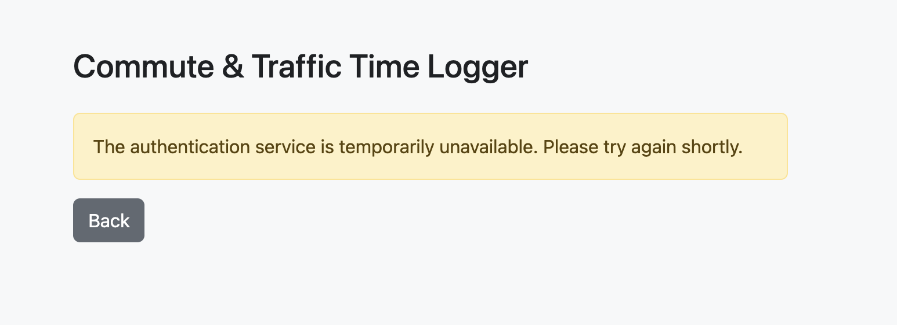

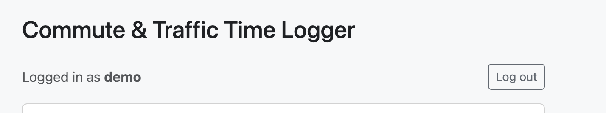

---

### 5.3 Persistence

- MySQL data lives in the named volume `mysql-data`, MongoDB data in `mongo-data`.
- `docker compose down` keeps the data; `docker compose down -v` deletes it.
- The database init scripts (`mysql/init.sql`, `mongo/init/01-init.js`) run **only when
  the volume is empty**. After changing them, or after changing database passwords in
  `.env`, run `docker compose down -v` and start again.

## 6. Performance & Observability

## 7. CI/CD Evidence

