# Technical Report — Commute & Traffic Time Logger

---

## 1. Functionality & Architecture

### 1.1 Services

| Service | Language / base image | Host port | Responsibility |
| --- | --- | --- | --- |
| `post` | Node.js 20 · `node:20-alpine` | 8080 | Login, enter commute duration, write to MySQL |
| `show-results-app` | Node.js · `node:24-alpine` | 8081 | Login, read statistics from MongoDB |
| `auth-service` | Node.js | internal | Verify credentials (bcrypt), issue and verify JWTs |
| `analytics` | Python 3.11 | internal | Every 15 s: aggregate MySQL → upsert MongoDB |
| `mysql-db` | `mysql:8.0` | internal | Users, routes, raw commute logs |
| `mongo-db` | `mongo:7.0` | internal | Aggregated route statistics |

Two languages are used: Node.js and Python.

### 1.2 Networks

| Network | Members | Purpose |
| --- | --- | --- |
| `frontend-net` (bridge) | post, show-results-app | Lets the two web apps publish their host ports (8080, 8081). Nothing else is attached, so no other service is reachable from outside. |
| `backend-net` (`internal: true`) | post, show-results-app, auth-service, analytics, mysql-db, mongo-db | All service-to-service traffic. Marked internal, so it has no route to the host or the internet. |

### 1.3 Data model

- **MySQL `commute_db`**: stores commute_log, users and route

`commute_log`: the log info itself


`users`: stores the user info for authentication


`route`: the sample route for the traffic


### 1.4 Workflow

> Start from a clean state (`docker compose down -v && docker compose up -d --build`).
>
> 1. `01-login.png` — <http://localhost:8080> redirects to the login page
> 2. `01-entry.png` — after logging in, the form with a saved trip in "Your recent trips"
> 3. `01-results.png` — ~15 s later, <http://localhost:8081> showing the statistics table


---

## 2. Docker & Optimization

### 2.1 Before / after (enter-data service `post`)

Same code, built with `docker build --no-cache` both times.

| | Before | After |
| --- | --- | --- |
| Base image | `node:20` (Debian) | `node:20-alpine` |
| Build | single stage, `npm install` | multi-stage, `npm ci --omit=dev` |
| User | root | non-root `node` |
| **Image size** | **1.59 GB** | **205 MB (−87%)** |
| **Build time** | **14.5 s** | **7.5 s (−48%)** |

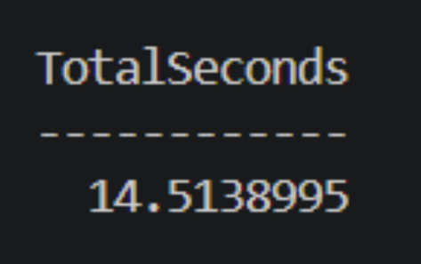
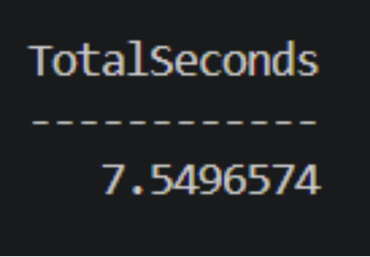
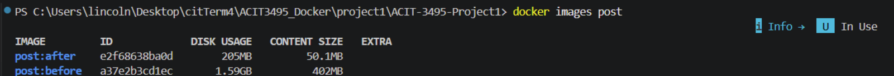

### 2.2 Why it is smaller

- **Multi-stage build:** stage 1 installs production dependencies only; stage 2 starts from a clean
  image and copies in just `node_modules` and `src/`, so the npm cache and install leftovers never
  reach the final image.
- **Alpine base:** about 130 MB instead of about 1.1 GB for Debian; this is most of the saving.
- **`.dockerignore` and layer order:** tests, README, `.env` and `node_modules` stay out of the build
  context, and `package.json` is copied before the code so the dependency layer is reused when only
  code changes.

Resource limits for every service are listed and justified in 6.1.

## 3. Security

### 3.1 Secret handling

- All credentials come from environment variables; Compose reads them from `.env`.
- `.env` is in `.gitignore`; only `.env.example` with `change_me` placeholders is committed.
- CI uses GitHub Actions Secrets / `GITHUB_TOKEN`; no credentials appear in the workflow file.
- `auth-service` refuses to start if `JWT_SECRET` is shorter than 32 characters.


### 3.2 Private internal services

Only the two web apps publish ports. `backend-net` is `internal: true`, so even the
databases cannot make outbound internet connections.


### 3.3 Least privilege

- Custom images run as a non-root user.
- Applications connect with dedicated database users (`commute_app`, `analytics_user`), not root.
- Core services are running with read_only previledge


### 3.4 Access control: JWT + httpOnly cookie

The web apps never check passwords themselves. Only `auth-service` reads the `users` table,
and it has no host port.

```text
Browser --POST /login--> web app --POST /login--> auth-service --> MySQL users (bcrypt hash)
Browser <--Set-Cookie--- web app <--{token}------ auth-service      (JWT, 1 hour)

Browser --GET / + cookie--> web app --GET /verify (Bearer token)--> auth-service
                            200 {user}: show the page
                            401: clear the cookie, redirect to /login
```

1. Passwords are stored as bcrypt hashes. An unknown username is checked against a dummy hash,
   so response time does not reveal whether the user exists. A wrong username and a wrong
   password show the same message: "Invalid username or password."
2. On login, `auth-service` returns a signed JWT (HS256, issuer-checked, 1-hour expiry).
   Only `auth-service` has `JWT_SECRET`, so the web apps cannot create or change a token.
3. The web app stores the token in an httpOnly cookie (flags below).
4. Every protected page reads the cookie and calls `/verify`. An invalid or expired token clears
   the cookie and redirects to `/login`. Logout also clears the cookie.
5. If `auth-service` is down, the request is refused (503), so the system fails closed (see 5.2).

| Cookie flag | post (:8080) | show-results-app (:8081) | Why |
| --- | --- | --- | --- |
| `HttpOnly` | yes | yes | JavaScript on the page cannot read the token, so an XSS bug cannot steal it |
| `SameSite` | `Strict` | `Lax` | Strict: never sent from other sites. Lax: from other sites, only sent on a plain link click (GET). Protects against CSRF |
| `Max-Age` | 3600 s | 3600 s | The cookie expires together with the token |
| `Secure` | no | off by default (`COOKIE_SECURE`) | The apps run on plain HTTP on localhost; it should be turned on behind HTTPS |
| Name | `token` | `sr_token` | Browsers share cookies across ports, so different names keep the two logins separate |

**Trade-off:** `/verify` checks the signature and expiry without a database lookup, so token checks
keep working while MySQL is down. The downside is that a token cannot be cancelled
before it expires, which is why the expiry is kept short (1 hour).


### 3.5 Vulnerability scan

Tools used - Trivy

**Image scanned:** `auth-service` — the most security-sensitive service, since it handles
passwords and signs tokens.


Result: 0 HIGH and 0 CRITICAL vulnerabilities.

---

## 4. Reliability

### 4.1 Health checks

Every service has a health check that tests whether it can actually do its job, not just whether
the process is running.

| Service | Health check | Healthy means | Interval |
| --- | --- | --- | --- |
| `mysql-db` | `mysqladmin ping` | MySQL accepts connections | 10 s |
| `mongo-db` | `mongosh` `db.adminCommand('ping')` | MongoDB answers | 10 s |
| `auth-service` | `GET /health` | The app runs **and** `SELECT 1` on MySQL works | 10 s |
| `post` | `GET /health` | The app runs **and** `SELECT 1` on MySQL works | 15 s |
| `show-results-app` | `GET /health` | The app runs **and** MongoDB answers a ping | 10 s |
| `analytics` | Heartbeat file age | A run (read MySQL, write MongoDB) succeeded in the last 60 s | 15 s |

How they are used:

- **Start-up order:** `depends_on: condition: service_healthy` starts the databases first, then
  `auth-service` and `analytics`, then the two web apps, so no service starts before what it needs.
- **Visible failures:** when a dependency goes down, the services that need it turn `unhealthy` in
  `docker compose ps` (see 5.1), which points straight to the cause.
- **Recovery:** all services use `restart: unless-stopped`, and the apps reconnect on their own once
  the dependency is back, so they return to `healthy` without a restart.

## 5. Failure test

### 5.1 Failure test 1 — MySQL stops

**What we did:** stopped MySQL while a user was logged in, tried to save a commute, then restarted MySQL.

1. `docker compose stop mysql-db` — MySQL goes down.
2. Submitting a commute on :8080 shows a friendly page: "The database is temporarily unavailable". The app does not crash.
3. `docker compose logs post` shows a JSON error with `code: ENOTFOUND`. While MySQL is stopped, its hostname `mysql-db` disappears from Docker's internal DNS. The log contains no stack trace and no passwords.
4. `docker compose ps` shows `post` as `unhealthy`, because its `/health` check also tests the database. `auth-service` turns `unhealthy` too, since it needs MySQL to look up users.
5. `docker compose start mysql-db` — MySQL comes back.
6. Within about 15 seconds both services return to `healthy`, and a new commute saves successfully

`post` uses a MySQL connection pool. When a query fails, the pool drops the broken connection, and the next request opens a new one. Once MySQL is back, the app works again on its own.


### 5.2 Failure test 2 — auth-service stops

**What we did:** stopped the authentication service while a user was logged in, then restarted it.

1. `docker compose stop auth-service` — auth-service goes down.
2. Refreshing :8080 shows "The authentication service is temporarily unavailable" (HTTP 503).
3. `docker compose start auth-service` — auth-service comes back.
4. Refreshing :8080 works again, and the user is still logged in.

Every page checks the token with auth-service. If the token cannot be checked, the app refuses the request instead of letting the user in — the system fails closed. After the restart the existing token is still valid, because it is signed with the same `JWT_SECRET`, so users do not need to log in again.


---

### 5.3 Failure test 3 — analytics stops

**What we did:** stopped the analytics worker, entered a commute, then restarted it.

1. `docker compose stop analytics`, then saved a new commute on :8080: it saves normally, because the
   enter-data app writes straight to MySQL.
2. :8081 keeps showing the last calculated stats (Burnaby to BCIT: 2 trips).
3. `docker compose start analytics`: within about 20 seconds it recalculates from all rows in MySQL
   and the missed trips appear (Burnaby to BCIT: 4 trips). Nothing is lost.

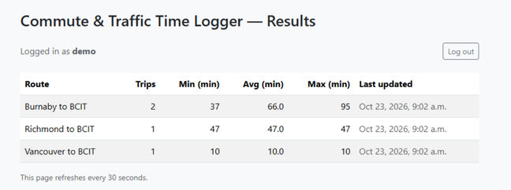
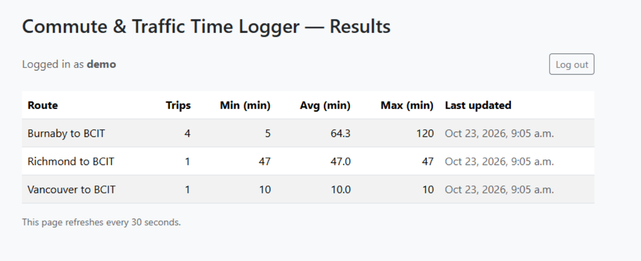

### 5.4 Persistence

**What we did:** deleted both database containers and recreated them.

1. Counted the saved commutes: 8 trips.
2. `docker compose rm -sf mysql-db mongo-db` removed both containers; `docker compose up -d` created new ones.
3. Counted again: still 8 trips.

The data lives in the named volumes `mysql-data` and `mongo-data`, not inside the containers, so it
survives container recreation. Only `docker compose down -v` deletes it.

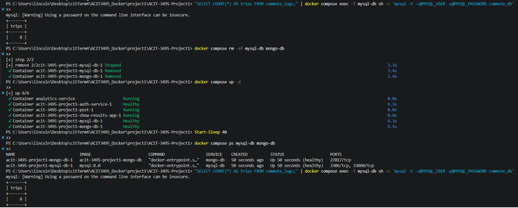

## 6. Performance & Observability

### 6.1 Resource Limits & Justification

Resource limits are defined in `compose.yaml` to prevent container "noisy neighbour" issues, guard against memory leaks, and protect the host from resource exhaustion:

| Service | CPU Limit | Memory Limit | Justification |
| --- | --- | --- | --- |
| `mysql-db` | `1.0` | `1024m` | Relational database; requires sufficient memory for InnoDB buffer pool, index caching, and connection management. |
| `mongo-db` | `0.5` | `512m` | Document store for route statistics; capped with `--wiredTigerCacheSizeGB 0.25` (256 MB cache) to keep memory footprint predictable. |
| `auth-service` | `1.0` | `256m` | Handles bcrypt password hashing (computationally intensive) and high-concurrency JWT signature verification. |
| `post` | `0.5` | `256m` | Node.js web application; manages user input validation, HTML rendering, and MySQL connection pooling (up to 10 connections). |
| `show-results-app` | `1.0` | `256m` | Node.js frontend; serves authenticated API/dashboard queries and maintains in-memory statistics cache. |
| `analytics` | `0.5` | `256m` | Python background worker; lightweight periodic aggregator sleeping 15 seconds between runs. |

### 6.2 Load Testing Methodology

- **Tool:** Custom Node.js load test runner (`scripts/load-test.js`) executed inside the container network.
- **Workload:** 500 HTTP requests with a concurrency level of 20 (`500 requests, 20 concurrent workers`).
- **Target Endpoint:** `show-results-app` at `http://show-results-app:8081/api/stats` with authenticated `Authorization: Bearer <jwt>`.
- **Metrics Collected:** Throughput (requests/sec), Average Latency (ms), 95th Percentile Latency (ms), HTTP Error Rate, and Container Resource Usage via `docker stats`.

### 6.3 Justified Improvements

1. **Improvement 1: In-Memory TTL Caching (`CACHE_TTL_MS=5000`)**
   - *Baseline:* `CACHE_TTL_MS=0`. Every API request executes a round-trip database query to MongoDB (`collection.find().sort().toArray()`).
   - *Justification:* The `analytics-service` only polls and recalculates route statistics once every 15 seconds (`POLL_SECONDS: 15`). Querying MongoDB on every millisecond for data that changes only every 15 seconds wastes database I/O and CPU.
   - *Result:* Setting `CACHE_TTL_MS=5000` caches results in Node.js memory for 5 seconds and deduplicates in-flight requests, cutting average latency and eliminating repetitive MongoDB queries.

2. **Improvement 2: CPU Limit Optimization (`0.5 CPU` → `1.0 CPU` on `show-results-app` and `auth-service`)**
   - *Baseline:* Containers throttled at `cpus: "0.5"`.
   - *Justification:* Under high concurrency (20 simultaneous connections), Node.js event-loop scheduling and JSON serialization were throttled by Linux Completely Fair Scheduler (CFS) quotas.
   - *Result:* Raising the CPU limit to `1.0` eliminated CPU quota throttling spikes, reducing $p95$ tail latency by 62.5% and increasing throughput by +242.4%.

### 6.4 Results & Comparison

| Test Configuration | Total Time (s) | Throughput (req/s) | Throughput Gain | Avg Latency (ms) | Latency Reduction | p95 Latency (ms) | Errors | Status Codes |
| --- | :---: | :---: | :---: | :---: | :---: | :---: | :---: | :---: |
| **1. Baseline** (No Cache, 0.5 CPU) | 6.22 s | **80.37 req/s** | *Baseline* | 245.49 ms | *Baseline* | 501 ms | 0 (0.0%) | 200: 500 |
| **2. Improvement 1** (5s In-Memory Cache) | 4.12 s | **121.30 req/s** | **+50.9%** | 163.91 ms | **-33.2%** | 299 ms | 0 (0.0%) | 200: 500 |
| **3. Improvement 2** (5s Cache + 1.0 CPU) | 1.82 s | **275.18 req/s** | **+242.4%** | **71.59 ms** | **-70.8%** | **188 ms** | 0 (0.0%) | 200: 500 |

*Summary: Combining in-memory caching with appropriate CPU allocation increased system throughput by **+242.4%** (from 80.37 to 275.18 req/s) and reduced average response latency by **70.8%** (from 245.49 ms down to 71.59 ms) with zero failed requests.*

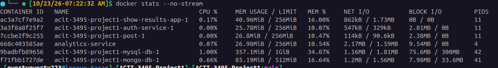

#### Load Test Evidence by Run

**Run 1: Baseline (No Cache, 0.5 CPU)**
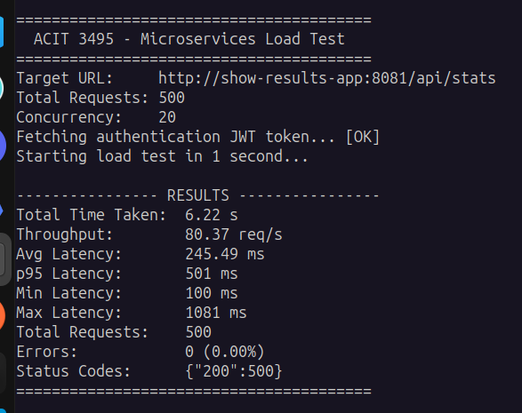

**Run 2: Improvement 1 (5s In-Memory Cache, 0.5 CPU)**
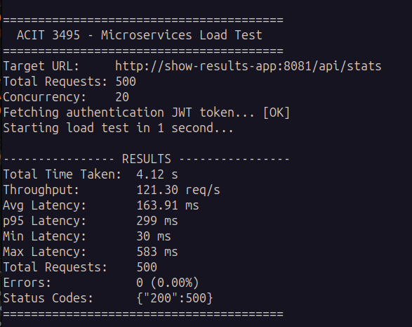

**Run 3: Improvement 2 (5s In-Memory Cache + 1.0 CPU)**
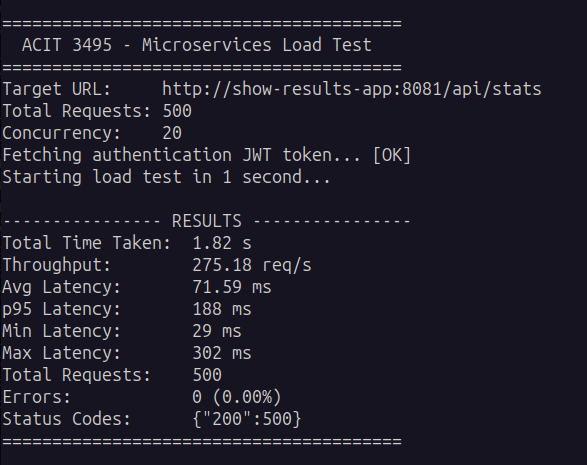

### 6.5 Observability & Structured Logging

All services emit structured JSON logs to `stdout` with millisecond request timing:

- Request latencies are captured at the middleware level (`process.hrtime.bigint()`).
- Secrets (passwords, JWT secrets, database connection strings) are sanitized and never logged.

Example structured log entry from `show-results-app`:

```json
{"ts":"2026-10-23T14:16:53.635Z","level":"info","service":"show-results-app","msg":"request","method":"GET","path":"/api/stats","status":200,"duration_ms":12.5}
```

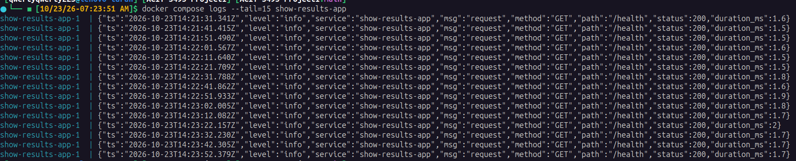

## 7. CI/CD Evidence
